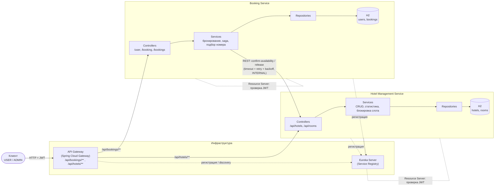
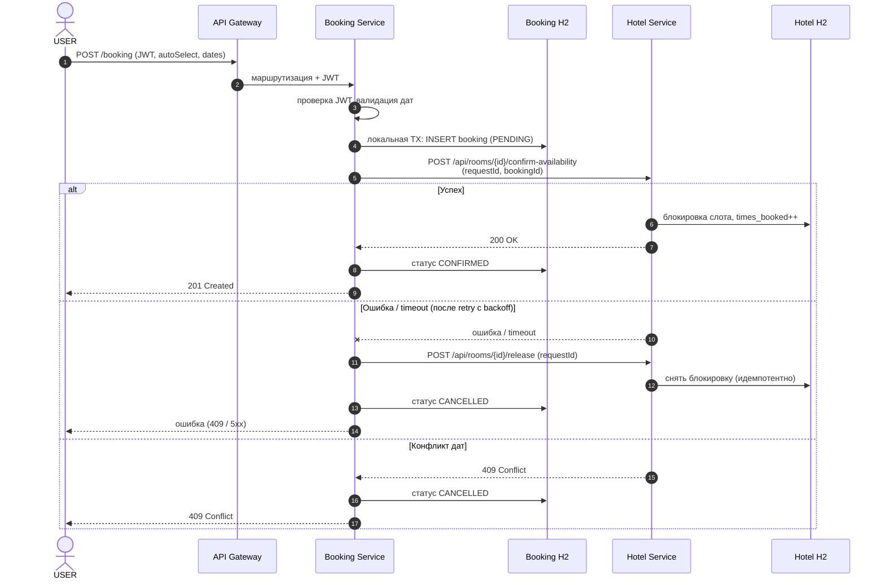
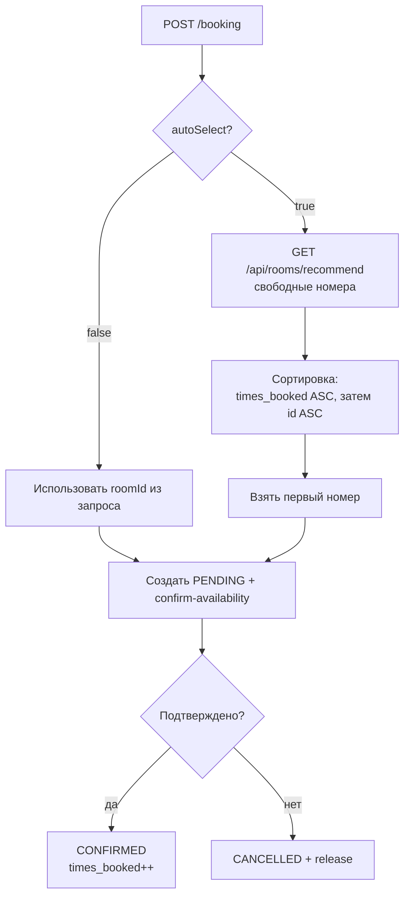
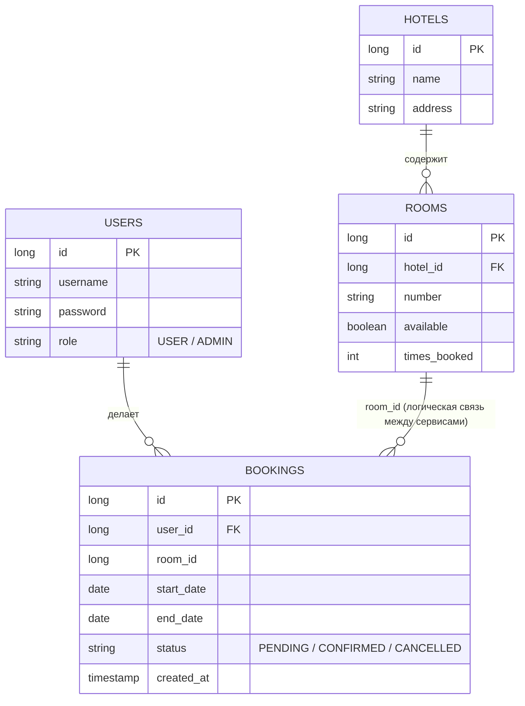
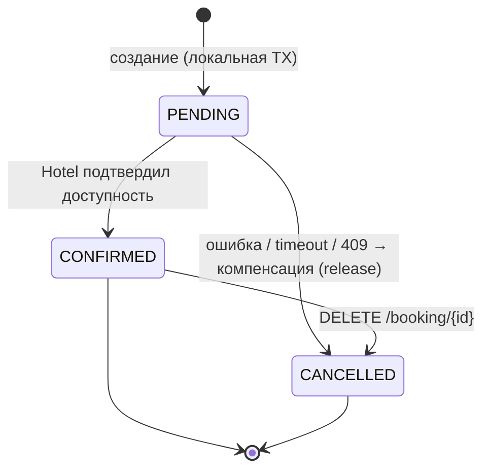

# Архитектура hotel-management

## 1. Архитектура компонентов

## 2. Сага создания бронирования (PENDING → CONFIRMED / CANCELLED)

## 3. Автоподбор номера (алгоритм занятости)

## 4. Модель данных

## 5. Состояния бронирования

Примечания:
- Связь `ROOMS ↔ BOOKINGS` логическая: таблицы лежат в разных сервисах и разных H2, внешнего ключа между ними нет.
- Переход `CONFIRMED → CANCELLED` выведен из `DELETE /booking/{id}`; в ТЗ он явно не описан.
