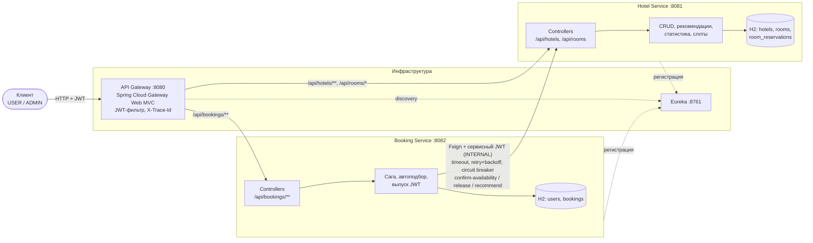

# hotel-management

REST API системы бронирования отелей на Spring Boot 3.5 и Spring Cloud 2025.0: микросервисы
управления бронированиями отелей, API Gateway, Eureka, JWT-безопасность, сага с компенсацией,
просмотр загрузки номеров, рекомендации по бронированию на основе загруженности.

[](https://github.com/dfedorino/hotel-management/actions/workflows/build.yml)
[](https://sonarcloud.io/summary/new_code?id=dfedorino_hotel-management)

Содержание:

- [Архитектура](#архитектура)
- [Запуск](#запуск)
- [Демо-данные и сценарий](#демо-данные-и-сценарий)
- [Эндпойнты](#эндпойнты)
- [Тестирование](#тестирование)
- [База данных](#база-данных)
- [Логи и трассировка](#логи-и-трассировка)
- [Соответствие ТЗ и критериям](#соответствие-тз-и-критериям)
- [ADR](#adr)

## Архитектура

| Модуль                                    | Назначение                                                                                            | Порт |
|-------------------------------------------|-------------------------------------------------------------------------------------------------------|------|
| `eureka-server`                           | реестр сервисов (Service Discovery)                                                                   | 8761 |
| `api-gateway`                             | единая точка входа: маршрутизация через Eureka, проверка JWT на входе, `X-Trace-Id`                   | 8080 |
| `hotel-service`                           | отели и номера (CRUD), поиск свободных, рекомендации, статистика загрузки, блокировка слотов для саги | 8081 |
| `booking-service`                         | пользователи, регистрация и вход (выпуск JWT), бронирования и сага с Hotel Service                    | 8082 |
| `hotel-service-api`                       | контракт Hotel Service (OpenAPI), модели, серверные интерфейсы, Feign-клиенты, декодер ошибок         | —    |
| `booking-service-api`                     | контракт Booking Service (OpenAPI), модели и серверные интерфейсы                                     | —    |
| `jwt-resource-server-spring-boot-starter` | общая проверка JWT для сервисов и Gateway: HS256, роли, JSON 401/403, `@PreAuthorize`                 | —    |
| `load-tests`                              | нагрузочные тесты Gatling (профиль `load-tests`)                                                      | —    |



## Запуск

### Docker Compose

Нужен только Docker (Compose v2).

```bash
docker compose up --build
```

## Демо-данные и сценарий

При старте в пустую базу загружается связанный набор данных, даты — относительно текущего дня:

| Что            | Данные                                                                                                                                           | Что демонстрирует                                                |
|----------------|--------------------------------------------------------------------------------------------------------------------------------------------------|------------------------------------------------------------------|
| Пользователи   | `admin` (ADMIN), `alice`, `bob` (USER); пароль у всех `demo-password`                                                                            | роли и разграничение доступа                                     |
| Grand Plaza    | номера 101 (`times_booked`=4), 102 (2), 103 (0), 104 (0), 105 (на ремонте, `available=false`)                                                    | сортировка рекомендаций; `available` не равно занятости по датам |
| Seaside Resort | номера 201 (3), 202 (1), 203 (0)                                                                                                                 | рекомендации по нескольким отелям                                |
| Бронирования   | №1 alice, номер 101, +7…+10 дней; №2 bob, 201, +3…+5; №3 alice, 102, +14…+21 — CONFIRMED, с соответствующими блокировками слотов в Hotel Service | история «только своё», пересечение дат, статистика загрузки      |

## Эндпойнты

Все пути — через Gateway (`http://localhost:8080`); сервисы получают их без изменений. Ошибки всех
сервисов и самого Gateway имеют единый формат `{timestamp, status, error, message, path}`.

**Booking Service** (`/api/bookings/**`)

| Метод и путь                                                    | Доступ      | Описание                                                                                                                                                                                |
|-----------------------------------------------------------------|-------------|-----------------------------------------------------------------------------------------------------------------------------------------------------------------------------------------|
| `POST /api/bookings/users/register`                             | все         | регистрация (роль USER) и токен (201)                                                                                                                                                   |
| `POST /api/bookings/users/auth`                                 | все         | вход, токен на 1 час                                                                                                                                                                    |
| `GET /api/bookings/users?page&size`                             | ADMIN       | пользователи постранично                                                                                                                                                                |
| `GET /api/bookings/users/{id}`                                  | ADMIN       | пользователь                                                                                                                                                                            |
| `POST /api/bookings/users`                                      | ADMIN       | создать пользователя с ролью                                                                                                                                                            |
| `PATCH /api/bookings/users/{id}`                                | ADMIN       | изменить переданные поля                                                                                                                                                                |
| `DELETE /api/bookings/users/{id}`                               | ADMIN       | удалить (409, если есть бронирования)                                                                                                                                                   |
| `GET /api/bookings/rooms/recommend?startDate&endDate[&hotelId]` | USER, ADMIN | свободные номера: `times_booked` по возрастанию, затем `id`                                                                                                                             |
| `POST /api/bookings`                                            | USER, ADMIN | создать бронирование: `roomId` или `autoSelect: true` (тогда `roomId` игнорируется); `requestId` — ключ идемпотентности; 409, если у пользователя уже есть бронь на пересекающиеся даты |
| `GET /api/bookings?page&size`                                   | USER, ADMIN | своя история, новые сверху                                                                                                                                                              |
| `GET /api/bookings/{id}`                                        | USER, ADMIN | своё бронирование (чужое — 404)                                                                                                                                                         |
| `DELETE /api/bookings/{id}`                                     | USER, ADMIN | отменить: снять слот в Hotel Service и CANCELLED; повторно — no-op                                                                                                                      |

**Hotel Service** (`/api/hotels/**`, `/api/rooms/*`)

| Метод и путь                                                          | Доступ                | Описание                                                                                   |
|-----------------------------------------------------------------------|-----------------------|--------------------------------------------------------------------------------------------|
| `GET /api/hotels`, `GET /api/hotels/{id}`                             | USER, ADMIN           | отели                                                                                      |
| `POST /api/hotels`, `PUT /api/hotels/{id}`, `DELETE /api/hotels/{id}` | ADMIN                 | CRUD отелей (удаление отеля с номерами — 409)                                              |
| `GET /api/rooms?hotelId&startDate&endDate`                            | USER, ADMIN           | свободные номера (по `id`): в работе и без пересекающихся блокировок                       |
| `GET /api/rooms/recommend?hotelId&startDate&endDate`                  | USER, ADMIN, INTERNAL | те же номера, `times_booked` ↑, затем `id`                                                 |
| `GET /api/rooms/{id}`                                                 | USER, ADMIN           | номер                                                                                      |
| `POST /api/rooms`, `PUT /api/rooms/{id}`, `DELETE /api/rooms/{id}`    | ADMIN                 | CRUD номеров                                                                               |
| `GET /api/rooms/occupancy?startDate&endDate[&hotelId]`                | ADMIN                 | статистика: занятые ночи и доля по номерам, средняя загрузка                               |
| `POST /api/rooms/{id}/confirm-availability`                           | INTERNAL, ADMIN       | шаг саги: блокировка слота (идемпотентно по `requestId`); **через Gateway не публикуется** |
| `POST /api/rooms/{id}/release`                                        | INTERNAL, ADMIN       | компенсация: снять блокировку (идемпотентно); **через Gateway не публикуется**             |

## Тестирование

```bash
./mvnw verify                                   # 227 теста + проверки качества
./mvnw -Pload-tests -pl load-tests gatling:test # нагрузочный тест (система должна быть запущена)
```

| Модуль                                    | Тестов | Покрытие строк / ветвлений |
|-------------------------------------------|--------|----------------------------|
| `hotel-service`                           | 95     | 92,4% / 83,3%              |
| `booking-service`                         | 100    | 93,0% / 87,3%              |
| `api-gateway`                             | 13     | 100% / 100%                |
| `jwt-resource-server-spring-boot-starter` | 9      | 100% / 100%                |
| `hotel-service-api`                       | 4      | 94,1% / 83,3%              |
| `eureka-server`                           | 1      | —                          |

Виды тестов:

- модульные (JUnit 5, Mockito, AssertJ)
- срезы `@WebMvcTest`/`@DataJpaTest`
- интеграционные `@SpringBootTest`, MockMvc, in-memory H2, WireMock
- ArchUnit-правила архитектуры.

Все тесты в стиле given/when/then, не зависят от окружения (случайные порты, in-memory базы, без
внешних сервисов).

Нагрузочный тест (`BookingLoadSimulation`, Gatling): 40 пользователей за 10 секунд регистрируются,
смотрят рекомендации и одновременно бронируют одни и те же даты с автоподбором, затем администратор
проверяет загрузку.

Проверки качества:

- Spotless (palantir-java-format)
- Checkstyle
- SpotBugs + find-sec-bugs
- PMD + CPD
- JaCoCo
- Maven Enforcer
- CI — GitHub Actions (собираются изменённые модули)
- SonarCloud

## База данных

Схема каждого сервиса создаётся Liquibase (`src/main/resources/db/changelog`), Hibernate только
проверяет соответствие сущностей (`ddl-auto: validate`).

**Booking Service**

| Таблица    | Колонки                                                                                                                                                                                                                         | Ключи, ограничения, индексы                                                                                                                                       |
|------------|---------------------------------------------------------------------------------------------------------------------------------------------------------------------------------------------------------------------------------|-------------------------------------------------------------------------------------------------------------------------------------------------------------------|
| `users`    | `id`, `username` (≤ 50), `password` (BCrypt), `role` (USER/ADMIN)                                                                                                                                                               | `pk_users`, `uq_users_username`                                                                                                                                   |
| `bookings` | `id`, `user_id`, `room_id`, `start_date`, `end_date` (день выезда, не занят), `status` (PENDING/CONFIRMED/CANCELLED), `created_at`, **`request_id`** (ключ идемпотентности), **`slot_request_id`** (ключ слота в Hotel Service) | `pk_bookings`, `fk_bookings_user → users`, `uq_bookings_request_id`, `uq_bookings_slot_request_id`, `idx_bookings_user_created (user_id, created_at)` для истории |

**Hotel Service**

| Таблица             | Колонки                                                                                                       | Ключи, ограничения, индексы                                                                                                                                                  |
|---------------------|---------------------------------------------------------------------------------------------------------------|------------------------------------------------------------------------------------------------------------------------------------------------------------------------------|
| `hotels`            | `id`, `name`, `address`                                                                                       | `pk_hotels`                                                                                                                                                                  |
| `rooms`             | `id`, `hotel_id`, `number`, `available` (операционная доступность), `times_booked` (действующие бронирования) | `pk_rooms`, `fk_rooms_hotel → hotels`, `uq_rooms_hotel_number`, `idx_rooms_times_booked (times_booked, id)` для рекомендаций                                                 |
| `room_reservations` | `id`, `room_id`, `booking_id`, `request_id`, `start_date`, `end_date`, `status` (ACTIVE/RELEASED)             | `pk_room_reservations`, `fk_reservations_room → rooms`, `uq_reservations_request_id`, `idx_reservations_room_dates (room_id, start_date, end_date)` для проверки пересечений |

`room_id` в `bookings` и `booking_id` в `room_reservations` — логические связи между сервисами,
внешних ключей между разными базами нет. Занятость по датам определяется блокировками
`room_reservations`, а не полем `available`.

## Логи и трассировка

- Каждый запрос получает trace (Micrometer Tracing, W3C `traceparent`): Gateway → сервис → Hotel
  Service через Feign. Клиент видит `X-Trace-Id` в каждом ответе Gateway, включая 401.
- Консоль:
  `[booking-service,<traceId>,<spanId>,bookingId=<id>] ... requestId=... booking CONFIRMED` — шаги
  саги (PENDING, CONFIRMED, CANCELLED, переход на следующий номер, компенсация и её результат)
  логируются с `bookingId` в MDC.
- Файл `logs/<сервис>.json`: одно событие в строке в формате ECS (Elastic Common Schema) с
  `service.name`, `log.level`, `traceId`, `spanId`, `bookingId` — для сборщиков логов.

## Соответствие ТЗ и критериям

### Критерии оценивания

| #  | Критерий (уровень на высший балл)                                                                                          | Чем подтверждается                                                                                                                                                                                                                                                                                                                                                                                                                                                                                                                                                                                                                                                                          |
|----|----------------------------------------------------------------------------------------------------------------------------|---------------------------------------------------------------------------------------------------------------------------------------------------------------------------------------------------------------------------------------------------------------------------------------------------------------------------------------------------------------------------------------------------------------------------------------------------------------------------------------------------------------------------------------------------------------------------------------------------------------------------------------------------------------------------------------------|
| 1  | Алгоритм занятости: параллельные бронирования, идемпотентность, работа под нагрузкой, равномерная загрузка без простоя (5) | сортировка `times_booked` ↑, `id` ↑ — `RoomRepository.findFree`, `RoomRecommendationServiceImpl`, тесты `FreeRoomQueryTest.filtersByHotelAndSortsByTimesBookedThenId`, `RoomRecommendationServiceImplTest`; блокировка строки номера — `RoomRepository.findByIdForUpdate`, тест `RoomAvailabilityServiceIntegrationTest.concurrentOverlappingConfirmsLetExactlyOneThrough`; идемпотентность по `requestId` — `repeatedConfirmWithSameRequestIdIsIdempotent`, `BookingFlowIntegrationTest.redeliveredRequest…`; автоподбор с переходом на следующий номер — `BookingSaga`, `BookingServiceImplTest.autoSelect…`; нагрузка — Gatling (0 ошибок, ни одного двойного бронирования, без простоя) |
| 2  | Сага с компенсацией и Retry/Timeout/CircuitBreaker (5)                                                                     | `BookingStore` + `BookingSaga` (ADR 0002), `HotelServiceAdapter` с `@Retry`/`@CircuitBreaker` и таймаутами Feign (ADR 0003); тесты `HotelServiceAdapterIntegrationTest` (повторы 5xx, три таймаута, 409 без повтора, размыкание), `BookingServiceImplTest` (компенсация, сбой компенсации), `BookingFlowIntegrationTest.bookingIsCompensatedWhenHotelTimesOut`                                                                                                                                                                                                                                                                                                                              |
| 3  | Booking Service: идемпотентность, пагинация, валидация дат (5)                                                             | `requestId` + `uq_bookings_request_id`; `GET /api/bookings?page&size` (`BookingPage`); `StayDates` (начало раньше конца, не в прошлом); «только свои» — `findByIdAndUserId`; не больше одной брони на одни даты — `BookingStore.createPending` (блокировка строки пользователя), тесты `BookingStoreTest.userCannotHoldTwoBookingsForOverlappingDates`, `BookingFlowIntegrationTest.secondBookingForTheSameDatesIsRefused…`; тесты `BookingServiceImplTest.historyIsPagedNewestFirst`, `datesAreValidated…`, `BookingFlowIntegrationTest.usersSeeOnlyTheirOwnBookings`                                                                                                                      |
| 4  | Hotel Service: фильтры/сортировки, расширенная аналитика (5)                                                               | фильтры `hotelId` и период для поиска, рекомендаций и статистики; две сортировки (по `id` и по загрузке); отчёт `GET /api/rooms/occupancy`: занятые ночи с учётом границ периода, доля загрузки по номерам, средняя загрузка — `OccupancyServiceImpl`, тесты `OccupancyServiceImplTest`, `FreeRoomQueryTest`                                                                                                                                                                                                                                                                                                                                                                                |
| 5  | Gateway + Eureka: маршрутизация с фильтрами безопасности и трассировкой (5)                                                | `RoutesConfig` (`lb://` через Eureka), проверка JWT на входе (`SecurityConfig`), `TraceIdResponseFilter`, внутренние пути не публикуются; тесты `GatewayRoutingIntegrationTest`, `GatewayTracingIntegrationTest`, `GatewayErrorsIntegrationTest`; ручная проверка: все сервисы в `/eureka/apps`                                                                                                                                                                                                                                                                                                                                                                                             |
| 6  | Безопасность: `@PreAuthorize`, 401/403, роли (5)                                                                           | Resource Server в каждом сервисе (`jwt-resource-server-spring-boot-starter`), `@PreAuthorize` на контроллерах, JSON 401/403 (`SecurityErrorHandler`); тесты `AccessControlIntegrationTest` (нет/чужой/просроченный токен, роли USER/ADMIN/INTERNAL), `AuthAndUsersIntegrationTest`, `JwtResourceServerCustomizerTest`                                                                                                                                                                                                                                                                                                                                                                       |
| 7  | Тестирование: параллельные брони, подтверждение и компенсация, негативные кейсы (3)                                        | 227 теста: параллельные подтверждения (8 потоков), сага и компенсация на WireMock, 400/401/403/404/409/503; нагрузочный тест Gatling                                                                                                                                                                                                                                                                                                                                                                                                                                                                                                                                                        |
| 8  | Расширенная схема БД и её документирование (2)                                                                             | Liquibase changelog с ключами, связями, индексами и комментариями; дополнительные таблица `room_reservations` и колонки `request_id`, `slot_request_id`; раздел [База данных](#база-данных), ADR 0007; тест `DatabaseSchemaTest`                                                                                                                                                                                                                                                                                                                                                                                                                                                            |
| 9  | Предзаполнение с учётом сценариев (2)                                                                                      | `DemoDataInitializer` в обоих сервисах, согласованные бронирования и блокировки; раздел [Демо-данные и сценарий](#демо-данные-и-сценарий); тесты `DemoDataInitializerTest`                                                                                                                                                                                                                                                                                                                                                                                                                                                                                                                  |
| 10 | SOLID, нет «божественных» классов, зависимости через интерфейсы, нет копипаста (3)                                         | сервисы за интерфейсами, сага за портом `HotelAvailability`, разделение `BookingServiceImpl`/`BookingSaga`/`RoomSelector`; общий код вынесен в starter и `*-api`; PMD (`GodClass`, `CouplingBetweenObjects`…) и CPD в сборке; ArchUnit `ArchitectureTest` (слои, интерфейсы, без циклов и field injection)                                                                                                                                                                                                                                                                                                                                                                                  |
| 11 | Единый стиль (форматтер/линтер), структура пакетов (2)                                                                     | Spotless + Checkstyle ломают сборку при нарушениях; пакеты `controller/service/repository/domain/mapper/exception/security/client`                                                                                                                                                                                                                                                                                                                                                                                                                                                                                                                                                          |
| 12 | Прозрачные исключения, единый ErrorDTO, корректные коды (2)                                                                | `ErrorResponse` из контракта, `GlobalExceptionHandler` в сервисах, `SecurityErrorHandler` для 401/403, `GatewayErrorAttributes` для ошибок Gateway; доменные исключения с кодами 400/401/404/409/503                                                                                                                                                                                                                                                                                                                                                                                                                                                                                        |
| 13 | Структурные логи, ключевые события, traceId (2)                                                                            | ECS JSON в `logs/*.json` (тест `StructuredLoggingTest`), traceId/spanId/bookingId в каждой строке, `X-Trace-Id`                                                                                                                                                                                                                                                                                                                                                                                                                                                                                                                                                                             |
| 14 | README с запуском, схемой, ADR (2)                                                                                         | этот файл, [ADR](#adr), [ARCHITECTURE.md](ARCHITECTURE.md)                                                                                                                                                                                                                                                                                                                                                                                                                                                                                                                                                                                                                                  |
| 15 | Читаемые тесты (AAA/GWT), разумные моки, независимость от окружения (2)                                                    | given/when/then во всех тестах, моки только на границах (репозитории, Hotel Service через WireMock), случайные порты и in-memory H2                                                                                                                                                                                                                                                                                                                                                                                                                                                                                                                                                         |

### Требования ТЗ

| Требование                                                                                                                                    | Где реализовано                                                                                          |
|-----------------------------------------------------------------------------------------------------------------------------------------------|----------------------------------------------------------------------------------------------------------|
| Gateway, Hotel Service, Booking Service, Eureka — самостоятельные Spring Boot приложения с H2                                                 | модули `api-gateway`, `hotel-service`, `booking-service`, `eureka-server`                                |
| Java 17+, Spring Boot 3.5.x, Spring Cloud по BOM, Lombok, MapStruct                                                                           | Java 21, Boot 3.5.16, Spring Cloud 2025.0.3 (корневой `pom.xml`), мапперы `*Mapper`                      |
| Слои: сущности User, Booking, Hotel, Room; JpaRepository; сервисы; контроллеры; Resource Server в каждом сервисе; `@Transactional`            | пакеты `domain`, `repository`, `service`, `controller`, `security` каждого сервиса                       |
| Регистрация и вход (JWT 1 час), просмотр отелей и номеров, бронирование, история                                                              | `/api/bookings/users/register`, `/api/bookings/users/auth`, `/api/hotels`, `/api/rooms`, `/api/bookings` |
| ADMIN: CRUD отелей, номеров, пользователей; статистика загрузки                                                                               | `HotelController`, `RoomController`, `UserController`, `OccupancyController`                             |
| Hotel Service ведёт `times_booked`; рекомендации по возрастанию `times_booked`, затем `id`; Booking Service возвращает отсортированный список | `RoomAvailabilityServiceImpl` (счётчик), `GET /api/rooms/recommend`, `GET /api/bookings/rooms/recommend` |
| PENDING → CONFIRMED; при ошибке/таймауте CANCELLED и `release`                                                                                | `BookingSaga`, ADR 0002                                                                                  |
| Локальные транзакции вместо распределённых                                                                                                    | `BookingStore`, отдельный `@Transactional` на каждый шаг                                                 |
| Таймаут и ограниченные повторы с увеличением интервала, затем компенсация                                                                     | Feign-таймауты, Resilience4j `@Retry` с экспоненциальной паузой, ADR 0003                                |
| Идемпотентность по корреляционному идентификатору                                                                                             | `requestId` в Booking и Hotel Service, ADR 0004                                                          |
| Сквозная корреляция по `bookingId`, логирование ключевых шагов                                                                                | MDC `bookingId`, раздел [Логи и трассировка](#логи-и-трассировка)                                        |
| Нет гонок; при параллельных попытках — 409 без дубликатов                                                                                     | блокировка строки номера, уникальные ключи, ADR 0004                                                     |
| Тесты успеха, ошибки сервиса, таймаута, повторной доставки                                                                                    | `BookingFlowIntegrationTest`, `HotelServiceAdapterIntegrationTest`                                       |
| `available` — операционная доступность, занятость — по датам                                                                                  | `rooms.available` + `room_reservations`                                                                  |
| Swagger/OpenAPI                                                                                                                               | contract-first, Swagger UI сервисов, ADR 0001                                                            |
| README: как пользоваться, эндпойнты, как тестировать                                                                                          | разделы выше                                                                                             |

## ADR

1. [Contract-first: OpenAPI-спецификация как источник API](docs/adr/0001-contract-first-openapi.md)
2. [Сага бронирования на локальных транзакциях](docs/adr/0002-booking-saga.md)
3. [Устойчивость вызовов Hotel Service](docs/adr/0003-resilience-of-hotel-calls.md)
4. [Идемпотентность и параллельные бронирования](docs/adr/0004-idempotency-and-concurrency.md)
5. [Безопасность: HS256 JWT и сервисный токен](docs/adr/0005-security-jwt.md)
6. [Gateway на Spring Cloud Gateway Server Web MVC](docs/adr/0006-gateway-web-mvc.md)
7. [Схема БД в Liquibase](docs/adr/0007-schema-with-liquibase.md)
8. [Качество кода и CI](docs/adr/0008-quality-gates-and-ci.md)
